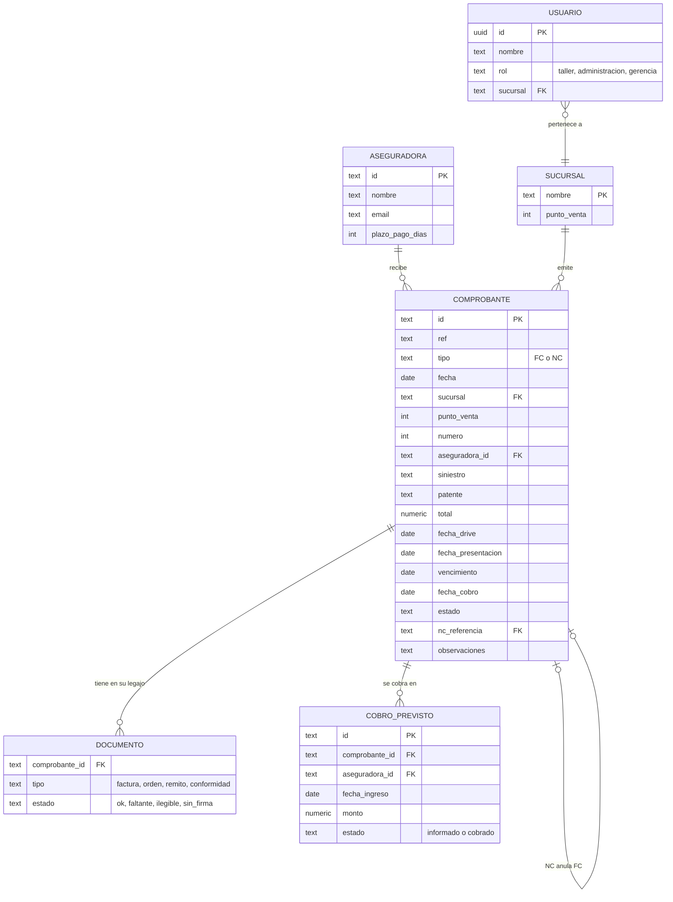

# Modelo de datos

El modelo sale de la planilla de control de facturación que se usa hoy, y se va a convertir en tablas de PostgreSQL (Supabase) en la etapa 2.

## De la planilla al modelo

| Hoja de la planilla | En CobroSync |
|---|---|
| Exportación del ERP | Formato de entrada del importador (etapa 2) |
| Diario | `comprobantes` + `documentos` (el legajo de cada factura) |
| Saldos | **Se calcula** desde `comprobantes` (`src/domain/finanzas.ts`) |
| Cobros Previstos | `cobros_previstos` |
| Info. Compañías | `aseguradoras` |

## DER

`SUCURSAL` y `USUARIO` todavía no existen como datos en la etapa 1 (la sucursal es un texto y el rol se elige en pantalla); se agregan con el login de la etapa 2.

## Reglas que no están en las tablas

Están en `src/domain/` y tienen tests:

- **Semáforo** (`semaforo.ts`): rojo si falta algún documento o tiene problemas; amarillo si está completo y no se cobró; verde si se cobró.
- **Saldos** (`finanzas.ts`): Pendiente = Facturado + NC − Cobrado. Vencido = presentada, sin cobrar y con el vencimiento pasado.
- **DSO**: días promedio entre la emisión y el cobro de las facturas cobradas en los últimos 90 días.
- **Proyección**: por vencimiento oficial de la factura vs. por fecha de ingreso informada por la compañía, agrupado en semanas (1 a 7, 8 a 14…).
